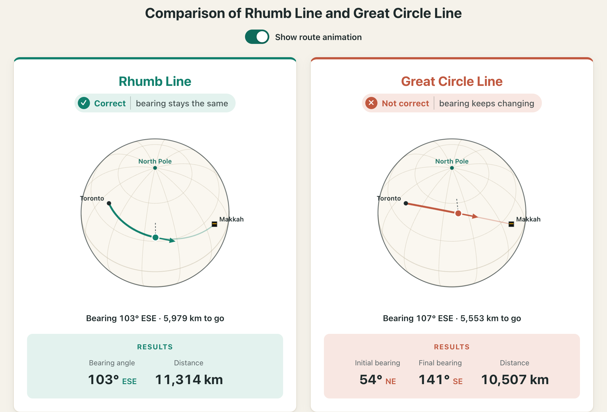

# Qibla in North America: Rhumb Line vs. Great Circle

**Live site: https://skababji.github.io/qibla_site/** · [العربية](https://skababji.github.io/qibla_site/ar/)

A small web app that calculates the Qibla direction from any city in the world
using two methods, the **rhumb line** (loxodrome) and the **great circle** (orthodrome),
and shows them side by side on two compasses. A **Show route animation** switch replaces
the compasses with a live animation of both routes on a globe for the selected city,
showing how the bearing stays fixed along the rhumb line but keeps changing along the
great circle.

The site argues that **the rhumb line is the method in line with the traditional way of
finding the Qibla.** For North America this gives an East/Southeast direction, not the
Northeast direction that most mosques use today.



## Why the rhumb line

Muslims traditionally found the Qibla using the four cardinal directions, taking their
bearings from the stars and from the North Pole as the fixed reference:

> وَعَلَامَاتٍ ۚ وَبِالنَّجْمِ هُمْ يَهْتَدُونَ
>
> "And landmarks. And by the stars they are guided." (An-Nahl 16:16)

A **rhumb line** keeps the **same angle to true north** for the whole journey. If you
face that bearing and walk, always measuring against north, you reach Mecca. This is the
same frame of reference as traditional star- and cardinal-direction navigation.

A **great circle** is the shortest path over the sphere, but its bearing to north
**changes continuously** along the route. Only the *initial* bearing is used for the
Qibla, and that bearing is not held anywhere else along the path. Its geometry is
defined relative to the **centre of the Earth** (the plane of the great circle passes
through it), not to the North Pole.

On the site, the rhumb-line compass stays fixed as you move the slider along the route,
while the great-circle compass keeps turning. With the route animation switched on, a
point travels each route on a globe: its heading arrow keeps the same angle to north on
the rhumb line, but swings round on the great circle (from Toronto: 54° at the start,
141° on arrival).

Knowledge of geometry is never a requirement for finding the Qibla in Shariah. If
mathematical models are used, though, they should keep to the original Shariah frame of
reference, and the rhumb line does that.

## The equations

Notation:

- $\varphi_1, \lambda_1$: latitude and longitude of your location (radians)
- $\varphi_2, \lambda_2$: latitude and longitude of the Kaaba (≈ 21.4225° N, 39.8262° E)
- $\Delta\varphi = \varphi_2 - \varphi_1$, $\quad \Delta\lambda = \lambda_2 - \lambda_1$
- $R$: mean radius of the Earth ≈ 6371 km
- $\theta$: bearing, measured clockwise from true north

### Rhumb line (loxodrome)

First compute the difference in *isometric latitude*, which is the north–south distance
on a Mercator projection:

```math
\Delta\psi = \ln\!\left(\frac{\tan\left(\frac{\pi}{4} + \frac{\varphi_2}{2}\right)}{\tan\left(\frac{\pi}{4} + \frac{\varphi_1}{2}\right)}\right)
```

The **constant bearing** (the same at every point on the route):

```math
\theta_{\text{rhumb}} = \mathrm{atan2}\left(\Delta\lambda,\ \Delta\psi\right)
```

Here $\Delta\lambda$ is first reduced to the range $[-\pi, \pi]$ so the route takes the
shorter way around in longitude.

The distance along the rhumb line:

```math
q = \begin{cases} \dfrac{\Delta\varphi}{\Delta\psi} & \text{if } \Delta\psi \neq 0 \\[2mm] \cos\varphi_1 & \text{if } \Delta\psi = 0 \end{cases}
```

The second case is a route running due east or west. Then:

```math
d_{\text{rhumb}} = R\sqrt{\Delta\varphi^2 + q^2\,\Delta\lambda^2}
```

On a Mercator map the rhumb line is a straight line, which is why sailors navigated with
it for centuries.

### Great circle (orthodrome)

The **initial bearing**, valid only at the starting point:

```math
x = \sin\Delta\lambda\,\cos\varphi_2
```

```math
y = \cos\varphi_1\sin\varphi_2 - \sin\varphi_1\cos\varphi_2\cos\Delta\lambda
```

```math
\theta_{\text{gc}} = \mathrm{atan2}\left(x,\ y\right)
```

The distance (haversine formula):

```math
\begin{aligned} a = {} & \sin^2\!\left(\frac{\Delta\varphi}{2}\right) \\ & + \cos\varphi_1\cos\varphi_2\sin^2\!\left(\frac{\Delta\lambda}{2}\right) \end{aligned}
```

```math
d_{\text{gc}} = 2R\,\mathrm{atan2}\left(\sqrt{a},\ \sqrt{1-a}\right)
```

Applying the bearing formula again at any point along the route gives a different
value, so the great-circle direction to Mecca keeps changing as you travel.

In both cases, normalise the bearing to between $0^\circ$ and $360^\circ$ with
$\theta = (\theta_{\text{deg}} + 360) \bmod 360$.

### Example results

Computed with the spherical formulas above:

| City       | Rhumb line bearing | Great circle initial bearing | Rhumb distance | Great circle distance |
| ---------- | ------------------ | ---------------------------- | -------------- | --------------------- |
| Toronto    | 103° (ESE)        | 55° (NE)                    | 11,320 km      | 10,496 km             |
| London, ON | 102° (ESE)        | 53° (NE)                    | 11,522 km      | 10,661 km             |
| Vancouver  | 102° (ESE)        | 17° (NNE)                   | 14,808 km      | 11,974 km             |
| Santiago   | 63° (ENE)         | 82° (E)                     | 13,223 km      | 13,149 km             |

The site runs entirely in the browser, using each city's coordinates from
`worldcities.csv` and the Kaaba's coordinates (21.422487° N, 39.826206° E). The rhumb
line is computed with the formulas above on a sphere of mean Earth radius; the great
circle is computed on the WGS-84 ellipsoid with
[GeographicLib](https://geographiclib.sourceforge.io/), so its results can differ slightly
from this table.

## Running locally

The site is plain static files. A small build script (Python standard library only)
splits `worldcities.csv` into one file per country and writes the site to `_site/`:

```bash
uv run build.py --serve
```

or, without uv, `python3 build.py --serve`. Then open http://127.0.0.1:5050, pick a
country and a city, and click **Calculate Bearing**.

Every push to `main` rebuilds and publishes the site to GitHub Pages automatically
(see `.github/workflows/pages.yml`).

## Project layout

| Path                                  | Purpose                                         |
| ------------------------------------- | ----------------------------------------------- |
| `web/index.html`, `web/static/`     | The web page, compasses, slider and route animation |
| `web/ar/index.html`                 | The same page in Arabic                         |
| `web/static/qibla.js`               | Rhumb line and great circle calculations        |
| `build.py`                          | Builds the static site into `_site/`            |
| `worldcities.csv`                   | Cities and their coordinates for the dropdowns  |
| `arabic_names.csv`                  | Arabic names for those cities (internal mapping, by city id) |
| `tools/arabic_names.py`             | Regenerates `arabic_names.csv` from GeoNames    |
| `.github/workflows/pages.yml`       | Publishes the site to GitHub Pages              |
| `docs/screenshot.png`               | Screenshot used in this README                  |

## Credits

- City data: [SimpleMaps World Cities Database](https://simplemaps.com/data/world-cities)
  (Basic version), licensed under
  [CC BY 4.0](https://creativecommons.org/licenses/by/4.0/).
- Arabic city names: [GeoNames](https://www.geonames.org/), licensed under
  [CC BY 4.0](https://creativecommons.org/licenses/by/4.0/). Cities without an Arabic name
  in GeoNames are shown in English.
- Geodesy: [GeographicLib](https://geographiclib.sourceforge.io/) by Charles Karney
  (MIT License), included in `web/static/vendor/`.

## Author

Samer El Kababji, PhD, P.Eng., London, Ontario
([ORCID 0000-0002-7642-2280](https://orcid.org/0000-0002-7642-2280))

If you use or build on this work, an acknowledgment would be appreciated. GitHub's
**Cite this repository** button (top right of the repo page) gives a ready-made citation.

## License

The code is released under the [MIT License](LICENSE). Third-party data keeps its own
license (see Credits).
