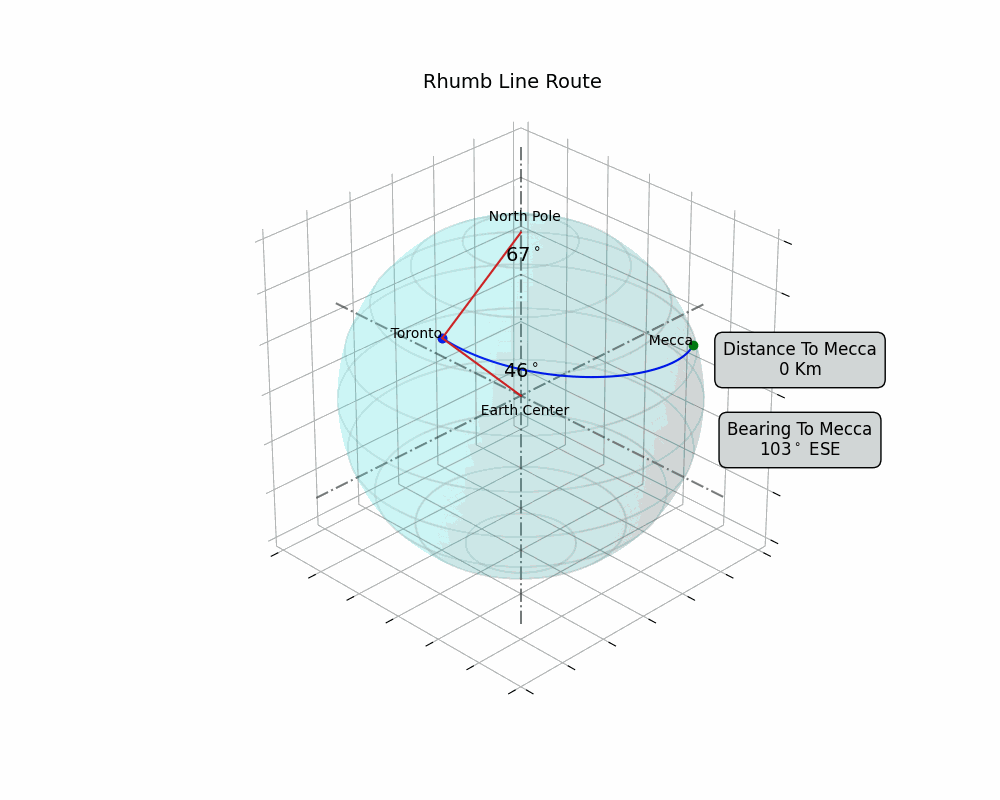
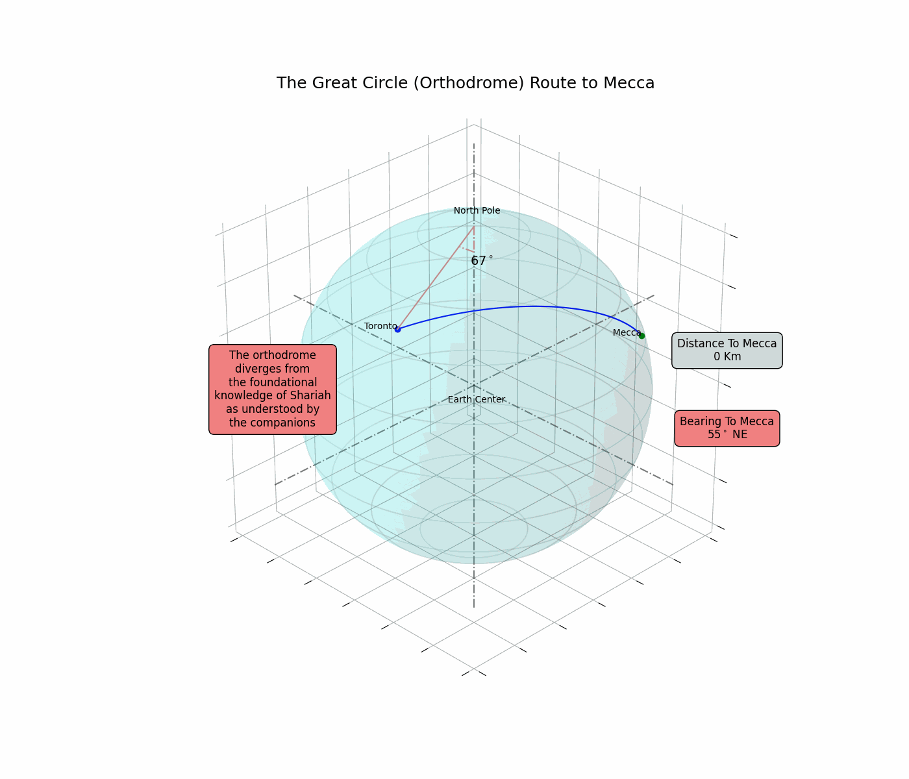

# Qibla in North America: Rhumb Line vs. Great Circle

A small Flask web app that calculates the Qibla direction from any city in the world
using two methods, the **rhumb line** (loxodrome) and the **great circle** (orthodrome),
and shows them side by side on two compasses. It also includes 3D animations of both
routes to Mecca from Toronto, Vancouver and Santiago.

The site argues that **the rhumb line is the method in line with the traditional way of
finding the Qibla.** For North America this gives an East/Southeast direction, not the
Northeast direction that most mosques use today.

| Rhumb line (Toronto)                                           | Great circle (Toronto)                                             |
| -------------------------------------------------------------- | ------------------------------------------------------------------ |
|  |  |

## Why the rhumb line

Muslims traditionally found the Qibla using the four cardinal directions, taking their
bearings from the stars and from the North Pole as the fixed reference:

> وَعَلَامَاتٍ ۚ وَبِالنَّجْمِ هُمْ يَهْتَدُونَ
>
> "And landmarks. And by the stars they are guided." (An-Nahl 16:16)

A **rhumb line** keeps the **same angle to true north** for the whole journey. If you
face that bearing and walk, always measuring against north, you reach Mecca. This is the
same frame of reference as traditional star- and cardinal-direction navigation.

A **great circle** is the shortest path over the sphere, but its bearing to north
**changes continuously** along the route. Only the *initial* bearing is used for the
Qibla, and that bearing is not held anywhere else along the path. Its geometry is
defined relative to the **centre of the Earth** (the plane of the great circle passes
through it), not to the North Pole.

On the site, the rhumb-line compass stays fixed as you move the slider along the route.
The great-circle compass keeps turning.

Knowledge of geometry is never a requirement for finding the Qibla in Shariah. If
mathematical models are used, though, they should keep to the original Shariah frame of
reference, and the rhumb line does that.

## The equations

Notation:

- $\varphi_1, \lambda_1$: latitude and longitude of your location (radians)
- $\varphi_2, \lambda_2$: latitude and longitude of the Kaaba (≈ 21.4225° N, 39.8262° E)
- $\Delta\varphi = \varphi_2 - \varphi_1$, $\quad \Delta\lambda = \lambda_2 - \lambda_1$
- $R$: mean radius of the Earth ≈ 6371 km
- $\theta$: bearing, measured clockwise from true north

### Rhumb line (loxodrome)

First compute the difference in *isometric latitude*, which is the north–south distance
on a Mercator projection:

$$
\Delta\psi = \ln\!\left(\frac{\tan\left(\frac{\pi}{4} + \frac{\varphi_2}{2}\right)}{\tan\left(\frac{\pi}{4} + \frac{\varphi_1}{2}\right)}\right)
$$

The **constant bearing** (the same at every point on the route):

$$
\theta_{\text{rhumb}} = \operatorname{atan2}\left(\Delta\lambda,\ \Delta\psi\right)
$$

Here $\Delta\lambda$ is first reduced to the range $[-\pi, \pi]$ so the route takes the
shorter way around in longitude.

The distance along the rhumb line:

$$
q = \begin{cases} \dfrac{\Delta\varphi}{\Delta\psi} & \text{if } \Delta\psi \neq 0 \\[2mm] \cos\varphi_1 & \text{if } \Delta\psi = 0 \text{ (due east/west)} \end{cases}
\qquad
d_{\text{rhumb}} = R\sqrt{\Delta\varphi^2 + q^2\,\Delta\lambda^2}
$$

On a Mercator map the rhumb line is a straight line, which is why sailors navigated with
it for centuries.

### Great circle (orthodrome)

The **initial bearing**, valid only at the starting point:

$$
\theta_{\text{gc}} = \operatorname{atan2}\left(\sin\Delta\lambda\cos\varphi_2,\ \cos\varphi_1\sin\varphi_2 - \sin\varphi_1\cos\varphi_2\cos\Delta\lambda\right)
$$

The distance (haversine formula):

$$
a = \sin^2\!\left(\frac{\Delta\varphi}{2}\right) + \cos\varphi_1\cos\varphi_2\sin^2\!\left(\frac{\Delta\lambda}{2}\right)
\qquad
d_{\text{gc}} = 2R\,\operatorname{atan2}\left(\sqrt{a},\ \sqrt{1-a}\right)
$$

Applying the bearing formula again at any point along the route gives a different
value, so the great-circle direction to Mecca keeps changing as you travel.

In both cases, normalise the bearing to $0^\circ$–$360^\circ$ with
$\theta = (\theta_{\text{deg}} + 360) \bmod 360$.

### Example results

Computed with the spherical formulas above:

| City       | Rhumb line bearing | Great circle initial bearing | Rhumb distance | Great circle distance |
| ---------- | ------------------ | ---------------------------- | -------------- | --------------------- |
| Toronto    | 103° (ESE)        | 55° (NE)                    | 11,320 km      | 10,496 km             |
| London, ON | 102° (ESE)        | 53° (NE)                    | 11,522 km      | 10,661 km             |
| Vancouver  | 102° (ESE)        | 17° (NNE)                   | 14,808 km      | 11,974 km             |
| Santiago   | 63° (ENE)         | 82° (E)                     | 13,223 km      | 13,149 km             |

The app uses the [`pygeodesy`](https://github.com/mrJean1/PyGeodesy) library. It
computes the rhumb line on a sphere and the great circle on the WGS-84 ellipsoid
(Vincenty), so its results can differ from this table by a fraction of a degree.

## Running locally

This project uses [uv](https://docs.astral.sh/uv/). With uv installed:

```bash
uv run app.py
```

uv installs the right Python version (see `.python-version`) and the locked
dependencies (`uv.lock`) on the first run. Then open http://127.0.0.1:5050, pick a
country and a city, and click **Calculate Bearing**.

To regenerate the route animations (GIFs):

```bash
uv run spherical_animation.py
```

## Project layout

| Path                                  | Purpose                                         |
| ------------------------------------- | ----------------------------------------------- |
| `app.py`                            | Flask app and the bearing/distance calculations |
| `templates/index.html`, `static/` | The web page, compasses and slider              |
| `spherical_animation.py`            | Generates the 3D route GIFs                     |
| `*_route.gif`                       | Pre-rendered route animations                   |
| `worldcities.csv`                   | Country/city list for the dropdowns             |
| `experiments/`                      | Early prototypes and notebooks                  |

## Credits

- City data: [SimpleMaps World Cities Database](https://simplemaps.com/data/world-cities)
  (Basic version), licensed under
  [CC BY 4.0](https://creativecommons.org/licenses/by/4.0/).
- Geocoding: [Nominatim](https://nominatim.org/) / OpenStreetMap, via
  [`geopy`](https://github.com/geopy/geopy). Data © OpenStreetMap contributors,
  [ODbL](https://www.openstreetmap.org/copyright).
- Geodesy: [`pygeodesy`](https://github.com/mrJean1/PyGeodesy).

## Author

Samer El Kababji, PhD, MEng, London, Ontario

## License

The code is released under the [MIT License](LICENSE). Third-party data keeps its own
license (see Credits).
